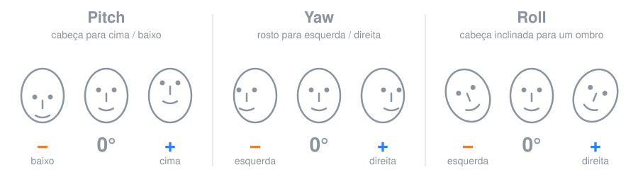

# images_positions

Validação de posicionamento de faces em imagens a partir dos ângulos **pitch**, **yaw** e **roll** da cabeça.

> Projeto de portfólio construído passo a passo. Este README registra cada etapa e as decisões tomadas.

## Objetivo

Receber uma imagem com um rosto, calcular a orientação da cabeça e **aprovar ou reprovar** a imagem conforme um limite de tolerância (*threshold*) para cada ângulo, funcionando como um *guardrail* de qualidade facial.

```text
imagem ──► detectar rosto ──► pitch / yaw / roll ──► comparar com limites ──► APROVADA / REPROVADA
```

<p align="center">
  
</p>

Rosto frontal: **pitch = yaw = roll = 0°**.

**Convenção de sinais** (esquerda e direita do ponto de vista de quem olha a imagem):

| Ângulo | Negativo (−) | Positivo (+) |
|--------|--------------|--------------|
| **Pitch** | cabeça para baixo | cabeça para cima |
| **Yaw**   | rosto virado para a esquerda | rosto virado para a direita |
| **Roll**  | cabeça inclinada para a esquerda | cabeça inclinada para a direita |

> Cada biblioteca e cada dataset pode usar uma convenção diferente. Ao comparar resultados, é preciso converter os sinais para esta convenção.

---

## Passo 1: Ambiente

Requer Python 3.10+ (desenvolvido com Python 3.14 no Ubuntu 26.04 via WSL).

### 1.1 Dependência de sistema: `libgles2`

O MediaPipe não é só Python: por baixo, ele carrega uma biblioteca compilada em C++ que usa **OpenGL ES** e depende do arquivo `libGLESv2.so.2` do sistema.
Instalações enxutas do Ubuntu, como a do WSL, não trazem esse pacote, e o `pip` não instala dependências de sistema.

```bash
sudo apt update
sudo apt install -y libgles2
```

Sem ele, o erro aparece ao criar o detector:

```text
OSError: libGLESv2.so.2: cannot open shared object file: No such file or directory
```

> Se o `apt` reclamar de `dpkg was interrupted` ou `Unmet dependencies`, alguma instalação anterior foi interrompida. Resolva antes com:
> `sudo dpkg --configure -a` e depois `sudo apt --fix-broken install -y`.

### 1.2 Ambiente virtual e pacotes Python

```bash
python3 -m venv .venv
source .venv/bin/activate
python -m pip install --upgrade pip
pip install mediapipe
```

O `mediapipe` já instala as dependências de que o projeto precisa, entre elas `numpy` e `opencv-contrib-python`.

> ⚠️ **Não instale `opencv-python` separadamente.** Ele disputa o mesmo `import cv2` com o `opencv-contrib-python` trazido pelo MediaPipe e causa conflitos.

## Passo 2: Modelo de detecção facial

Usamos a API **MediaPipe Tasks** (`mediapipe.tasks.vision.FaceLandmarker`).
A API antiga (`mp.solutions.face_mesh`) foi descontinuada e **não existe mais** a partir do MediaPipe 1.x.

A API Tasks exige baixar o modelo separadamente:

```bash
mkdir -p models
wget -O models/face_landmarker.task https://huggingface.co/litert-community/MediaPipe-FaceLandmarker/resolve/main/face_landmarker.task
```

O arquivo `face_landmarker.task` (3,6 MB) é um *bundle* com três modelos em sequência:

```text
imagem ──► detector de rosto (BlazeFace) ──► 478 pontos 3D do rosto ──► expressões (52 blendshapes) + matriz de pose 4x4
```

**Sobre o link:** a documentação oficial passou a hospedar o modelo no Hugging Face (`litert-community`).
O endereço antigo (`storage.googleapis.com/mediapipe-models/...`), comum em tutoriais, ainda funciona, mas pode sair do ar.
Antes de usar, confira sempre o link na [documentação do Face Landmarker](https://developers.google.com/edge/mediapipe/solutions/vision/face_landmarker).
Os dois endereços entregam o mesmo arquivo:

```text
MD5: b0e7274907a1644404fef66b28dd6d85
```

Verificação: `md5sum models/face_landmarker.task`

## Passo 3: Detectar os pontos do rosto

Script: [`scripts/01_detectar_landmarks.py`](scripts/01_detectar_landmarks.py). Execute **a partir da raiz do projeto**, porque os caminhos são relativos:

```bash
python scripts/01_detectar_landmarks.py
```

Saída:

```text
Rostos encontrados: 1
Pontos no rosto: 478
Ponto 1 (ponta do nariz): NormalizedLandmark(x=0.503, y=0.628, z=-0.121, ...)
```

O resultado (`FaceLandmarkerResult`) organiza os pontos como **lista de rostos → lista de pontos**:

```text
result.face_landmarks          → todos os rostos encontrados
result.face_landmarks[0]       → os 478 pontos do 1º rosto
result.face_landmarks[0][1]    → o ponto de índice 1 (ponta do nariz) do 1º rosto
```

Cada ponto tem coordenadas **normalizadas**:
- `x` e `y` vão de 0 a 1, em proporção à largura e à altura da imagem (`x = 0.5` é o meio da foto);
- `z` é a profundidade relativa: quanto mais negativo, mais perto da câmera.

> As linhas `WARNING`, `W0000` e `INFO` na saída são logs internos do MediaPipe, não erros.

### Imagem sem rosto: primeira regra do guardrail

Se não houver rosto, `result.face_landmarks` vem como lista vazia `[]`, e acessar `[0]` quebraria o programa com `IndexError`.
O script verifica antes e **reprova a imagem com o motivo**:

```python
if not result.face_landmarks:          # lista vazia conta como falso em Python
    print("REPROVADA: nenhum rosto encontrado na imagem.")
```

| Imagem de teste | Resultado |
|-----------------|-----------|
| com um rosto    | 478 pontos detectados |
| sem rosto       | `REPROVADA: nenhum rosto encontrado na imagem.` |

## Passo 4: Calcular pitch, yaw e roll

Script: [`scripts/02_calcular_angulos.py`](scripts/02_calcular_angulos.py). Ele percorre todas as imagens `.jpg` de `data/`:

```bash
python scripts/02_calcular_angulos.py
```

```text
image_01.jpg: pitch=-13.0°  yaw=-1.2°  roll=0.7°
image_02.jpg: pitch=-5.3°  yaw=1.9°  roll=-0.3°
image_03.jpg: pitch=3.4°  yaw=2.7°  roll=-1.4°
sem_rosto.jpg: REPROVADA: nenhum rosto encontrado na imagem.
```

Como ler o resultado da `image_01.jpg`: a cabeça está **13° para baixo**, e yaw e roll ficam em torno de 1°, o que na prática é um rosto de frente (essa variação está dentro da margem de erro do modelo).

### 4.1 Da imagem à matriz de pose

O MediaPipe não devolve os ângulos prontos. Ele devolve uma **matriz de pose 4x4** por rosto, desde que a opção seja ativada no detector:

```python
output_facial_transformation_matrixes=True   # o padrão é False
```

A matriz fica em `result.facial_transformation_matrixes[0]` e diz quanto um rosto 3D padrão (o *canonical face model*) teve que ser **girado** e **deslocado** para coincidir com o rosto da foto:

```text
┌─ rotação (3x3) ─────┐ ┌ translação ┐
[ 1.000   0.007  -0.022 │   0.211 ]   x
[-0.011   0.974  -0.224 │  -1.834 ]   y
[ 0.020   0.225   0.974 │ -34.374 ]   z: ~34 cm da câmera
[ 0       0       0     │   1     ]   linha fixa
```
<sub>Matriz da `image_01.jpg`, impressa pelo script.</sub>

Para a orientação da cabeça interessa só o bloco de **rotação**, que o código separa com um fatiamento do NumPy:

```python
r = result.facial_transformation_matrixes[0][:3, :3]   # 3 primeiras linhas e 3 primeiras colunas
```

> **Por que a matriz do MediaPipe, e não `cv2.solvePnP`?** A abordagem clássica estima a pose com o `solvePnP` do OpenCV, a partir de uns 6 pontos do rosto, de um modelo 3D genérico e de uma câmera estimada. A matriz do MediaPipe já é calculada pelo próprio modelo, usando os 478 pontos, então o código fica menor e não depende de chutar os parâmetros da câmera.

### 4.2 A matriz de rotação, em desenho

👉 **[Abrir a animação interativa](https://claude.ai/artifact/RApU88BF746By99rL7knf4)** (também em [`docs/matriz-rotacao.html`](docs/matriz-rotacao.html): baixe o arquivo e abra no navegador)

Uma cabeça em 3D gira na tela e a matriz muda ao vivo, em 8 passos. A ideia central:

- Três setas ficam presas na cabeça: **vermelha (x)**, no lado; **verde (y)**, no topo da cabeça; e **azul (z)**, no nariz.
- **Cada coluna** da matriz é uma seta. **Cada linha** pergunta quanto essa seta aponta para a direita da imagem, para cima ou para a câmera.
- Em cada giro, **uma seta fica parada** (é o eixo do giro) e as outras duas se inclinam:

| Movimento | Seta parada | Casas que mudam |
|-----------|-------------|-----------------|
| **Pitch** (fazer "sim") | vermelha (x) | [cima, azul (z)] e [câmera, verde (y)] |
| **Yaw** (fazer "não") | verde (y) | [direita, azul (z)] e [câmera, vermelha (x)] |
| **Roll** (orelha no ombro) | azul (z) | [direita, verde (y)] e [cima, vermelha (x)] |

Na `image_01.jpg`, só as casas do pitch fogem de 0 e 1 (−0.224 e 0.225): a cabeça está cerca de 13° para baixo.

### 4.3 Da matriz aos ângulos

No código, cada casa é lida como `r[linha, coluna]`, contando a partir de 0:

| | coluna 0: vermelha (x) | coluna 1: verde (y) | coluna 2: azul (z) |
|---|---|---|---|
| **linha 0: direita** | `r[0, 0]` | `r[0, 1]` | `r[0, 2]` |
| **linha 1: cima** | `r[1, 0]` | `r[1, 1]` | `r[1, 2]` |
| **linha 2: câmera** | `r[2, 0]` | `r[2, 1]` | `r[2, 2]` |

Cada ângulo sai de duas casas: uma faz o papel do **seno** e a outra do **cosseno** do giro. A função `math.atan2(seno, cosseno)` faz a conta ao contrário e devolve o ângulo:

```python
pitch = -math.degrees(math.atan2(r[2, 1], r[2, 2]))
yaw = math.degrees(math.atan2(-r[2, 0], math.hypot(r[0, 0], r[1, 0])))
roll = -math.degrees(math.atan2(r[1, 0], r[0, 0]))
```

| Ângulo | Seno (quanto inclinou) | Cosseno (quanto continua no lugar) |
|--------|------------------------|------------------------------------|
| Pitch | `r[2, 1]`: o topo da cabeça vem para a câmera | `r[2, 2]`: o nariz continua apontando para a câmera |
| Yaw | `-r[2, 0]`: o lado da cabeça se afasta da câmera | `hypot(r[0, 0], r[1, 0])`, ou seja, √(r[0,0]² + r[1,0]²) |
| Roll | `r[1, 0]`: o lado da cabeça sobe ou desce | `r[0, 0]`: o lado continua apontando para a direita |

- **Por que `atan2` e não o seno de uma casa só?** Quando os três giros acontecem juntos, eles se misturam nas casas. Usar duas casas mantém o resultado correto e com o sinal certo em qualquer combinação.
- `math.degrees` converte de radianos (o que o `atan2` devolve) para graus.
- A ordem dos giros é **R = Rz(roll) · Ry(yaw) · Rx(pitch)**, a decomposição mais usada para pose de cabeça.

### 4.4 Ajuste de sinais

O MediaPipe usa os eixos do padrão **OpenGL**: x para a direita da imagem, y para cima e z apontando para a câmera.
Nesse sistema, dois ângulos saem com o sinal oposto ao da [convenção do projeto](#objetivo), por isso levam um `-` no código:

| Ângulo | Sinal "natural" da matriz | Convenção do projeto | No código |
|--------|---------------------------|----------------------|-----------|
| Pitch | + = cabeça para baixo | + = cabeça para cima | inverte (`-`) |
| Yaw | + = rosto para a direita | + = rosto para a direita | mantém |
| Roll | + = inclinada para a esquerda | + = inclinada para a direita | inverte (`-`) |

**Decisão:** manter a convenção do projeto em vez do sinal "natural" da matriz. Ela é mais intuitiva (para cima e para a direita são positivos) e não depende da biblioteca: se o MediaPipe for trocado por outro modelo, os limites do guardrail continuam valendo.
Esquerda e direita são sempre **de quem olha a imagem**, porque é o que o programa enxerga: ele não sabe qual é a direita da pessoa, só onde estão os pixels.

**Como os sinais foram conferidos:**

| Ângulo | Teste |
|--------|-------|
| Roll | As fotos foram giradas em ±20° com o OpenCV. O script devolveu ±20° (erro ≤ 2°). |
| Yaw | As fotos foram espelhadas, o que inverte o yaw. Nos 6 casos (3 fotos × original e espelhada), yaw positivo coincidiu com o nariz mais perto da bochecha direita da imagem. |
| Pitch | Pitch mais negativo coincidiu com o nariz mais perto do queixo (cabeça baixa). A `image_01.jpg`, de queixo levemente abaixado, dá −13°. |

> As três fotos de teste são quase frontais. Ângulos grandes serão avaliados no passo de precisão, contra um dataset com ângulos reais.

### 4.5 Uma imagem ou a pasta inteira

O script processa todas as imagens de `data/` num laço:

```python
for caminho in sorted(Path("data").glob("*.jpg")):
```

- `Path("data").glob("*.jpg")` lista os arquivos `.jpg` da pasta, e `sorted` garante sempre a mesma ordem.
- Se a imagem não tem rosto, o script imprime o motivo e usa `continue` para seguir para a próxima, sem quebrar o laço.

## Passo 5: Benchmark de precisão *(planejamento)*

Antes de definir os limites do guardrail, é preciso saber **quanto o MediaPipe erra**.
Um limite de ±5° só faz sentido se o modelo medir os ângulos com erro bem menor que 5°: se ele erra 4°, uma foto com pitch real de 8° pode ser medida como 4° e aprovada por engano.
Por isso o benchmark vem **antes** do guardrail.

### 5.1 O que o benchmark precisa responder

| Pergunta | Como responder |
|----------|----------------|
| Quanto o MediaPipe erra em cada ângulo? | **MAE** e **RMSE** de pitch, yaw e roll |
| Em que faixa de ângulos ele é confiável? | Gráfico de **erro × ângulo real**. O esperado é errar pouco perto de 0° e mais com a cabeça muito virada. |
| O guardrail decide certo? | Comparar a decisão (aprovar/reprovar) tomada com os ângulos medidos e a tomada com os ângulos reais: quantas fotos foram **aprovadas por engano** e quantas foram **reprovadas por engano** |

A terceira pergunta é a que mais importa para um guardrail: o objetivo final não é medir ângulos, é **decidir certo**.

### 5.2 Métricas

Para cada imagem *i*, o erro é a diferença entre o ângulo medido pelo MediaPipe e o ângulo real anotado no dataset:

$$\text{MAE} = \frac{1}{N}\sum_{i=1}^{N} \left|\,\text{medido}_i - \text{real}_i\,\right| \qquad \text{RMSE} = \sqrt{\frac{1}{N}\sum_{i=1}^{N} \left(\text{medido}_i - \text{real}_i\right)^2}$$

| Métrica | Leitura | Por que usar |
|---------|---------|--------------|
| **MAE** (erro absoluto médio) | "em média, erra X graus" | É a métrica padrão nos artigos de pose de cabeça, então o resultado fica comparável com modelos publicados |
| **RMSE** (raiz do erro quadrático médio) | pesa mais os erros grandes | Se o RMSE for bem maior que o MAE, existem erros grandes ocasionais, que são os que mais prejudicam o guardrail |

> **Por que não usar o erro quadrático total (soma dos quadrados)?** Ele cresce com o número de imagens: 4.000 fotos dariam o dobro do erro de 2.000, mesmo com o modelo igual. MAE e RMSE são médias, então dá para comparar datasets de tamanhos diferentes.

### 5.3 Escolha do dataset

| | **AFLW2000-3D** ✅ escolhido | **BIWI Kinect Head Pose** |
|---|---|---|
| Pessoas diferentes | cerca de 2.000 (fotos variadas da internet) | 20 (gravadas em laboratório) |
| Imagens | 2.000 fotos independentes | cerca de 15.000 quadros de vídeo, muitos quase iguais entre si |
| Origem dos ângulos | modelo 3D ajustado a cada foto | sensor de profundidade (Kinect) |
| Comparável com artigos | sim, é o benchmark mais usado | sim |
| Licença | pesquisa não comercial | pesquisa não comercial |

**Decisão:** começar pelo **AFLW2000-3D**, pela diversidade de pessoas e por ser o benchmark mais citado. O BIWI pode entrar depois como segunda opinião: resultados parecidos nos dois tornam a conclusão mais forte.

**Limitação conhecida:** com a cabeça muito virada (acima de ~60°), as anotações do AFLW2000-3D ficam menos confiáveis. Isso pesa pouco aqui, porque os limites do guardrail ficam entre 5° e 20°.

**Cuidado:** os ângulos do dataset seguem a convenção de sinais dele, e não necessariamente a [convenção do projeto](#objetivo). A conversão será conferida antes de calcular qualquer métrica.

### 5.4 Licenças e uso dos dados

Uma licença de dataset pode restringir duas coisas diferentes:

| Restrição | O que proíbe | AFLW2000-3D e BIWI |
|-----------|--------------|--------------------|
| **Redistribuição** | publicar ou compartilhar cópias das imagens (GitHub, Drive, site) | proibida |
| **Uso comercial** | usar os dados num produto ou serviço pago, inclusive só para testá-lo | proibido: licença só para pesquisa |

Consequências para este projeto:

- **Pode ser publicado:** o código, as métricas, os gráficos e as conclusões, como fazem os artigos científicos.
- **Não pode ser publicado:** as imagens dos datasets, nem prints com rostos delas. Os exemplos visuais do README usam apenas fotos próprias. A pasta `data/` fica fora do Git (`.gitignore`).
- **Uso comercial futuro:** exigiria refazer o benchmark com um dataset de licença comercial ou com fotos próprias tiradas com consentimento. A LGPD classifica dado biométrico como **dado pessoal sensível** (art. 5º, II), o que exige consentimento específico.
- **Código e modelo:** o MediaPipe e o modelo `face_landmarker.task` usam a licença Apache 2.0, que permite uso comercial. A restrição está só nos datasets.

> Esta seção resume as licenças para orientar o projeto. Não é um parecer jurídico.

### 5.5 Limites de referência para o guardrail

O guardrail terá dois perfis. Os valores de partida vêm de normas e serão revistos com o resultado do benchmark:

| Perfil | Pitch | Yaw | Roll | Referência |
|--------|-------|-----|------|------------|
| **documento** (passaporte, RG) | ±5° | ±5° | ±8° | ISO/IEC 19794-5 (com *corrigendum* que levou o roll a ±8°) e ISO/IEC 39794-5:2019, Anexo D.2, adotadas pela ICAO no Doc 9303 |
| **cadastro** (reconhecimento facial) | ±15° | ±15° | ±20° | rascunho da ISO/IEC 25447, para captura em condições menos controladas (ainda não é norma adotada) |

- Na prática, fornecedores usam valores próprios. A IDEMIA, por exemplo, apresentou limites operacionais de yaw 10,3°, pitch 15° e roll 8°.
- Um documento de trabalho da ICAO de 2017 registra que a tecnologia de controle de qualidade da época **não conseguia confirmar a pose com precisão de ±5°**. É exatamente o que o benchmark vai medir no MediaPipe.

> Os valores das normas vêm de fontes secundárias (NIST e documentos de trabalho da ICAO), porque o texto das normas ISO é pago. As fontes estão em [Referências](#referências).

---

## Estrutura

```text
images_positions/
├── data/       # imagens de teste (não versionado)
├── docs/       # ilustrações e a animação da matriz de rotação
├── models/     # face_landmarker.task (não versionado)
└── scripts/    # scripts numerados, um por etapa
```

## Roteiro

- [x] Ambiente Python e dependências
- [x] Download e verificação do modelo
- [x] Detectar o rosto e os pontos faciais (*landmarks*)
- [x] Calcular pitch, yaw e roll
- [ ] Medir a precisão contra dataset com ângulos reais (AFLW2000-3D; MAE / RMSE)
- [ ] Guardrail com perfis *documento* e *cadastro*, limites revistos pelo benchmark
- [ ] Interface para o usuário enviar imagens
- [ ] Suporte a vídeo
- [ ] Testes automatizados

## Referências

- [MediaPipe Face Landmarker: visão geral](https://developers.google.com/edge/mediapipe/solutions/vision/face_landmarker)
- [MediaPipe Face Landmarker: guia Python](https://developers.google.com/edge/mediapipe/solutions/vision/face_landmarker/python)
- [MediaPipe API Python: `FaceLandmarkerResult`](https://developers.google.com/edge/api/mediapipe/python/mp/tasks/vision/FaceLandmarkerResult)

**Normas e limites de pose (passo 5.5):**

- [NIST, IFPC 2025: perfis da ISO/IEC 39794-5 e rascunho da ISO/IEC 25447](https://pages.nist.gov/ifpc/2025/presentations/12.pdf)
- [ICAO, TAG/MRTD 18, WP10: *corrigendum* da ISO/IEC 19794-5 (roll ±8°)](https://www.icao.int/Meetings/TAG-MRTD/Documents/Tag-Mrtd-18/TagMrtd18_wp10.pdf)
- [ICAO, TAG/MRTD 17, WP009: limite das ferramentas de controle de qualidade em ±5°](https://www2023.icao.int/Meetings/TAG-MRTD/Documents/Tag-Mrtd-17/TagMrtd17_WP009.pdf)
- [ICAO: perfil de aplicação da ISO/IEC 39794-5](https://icao.int/Security/FAL/TRIP/PublishingImages/Pages/Publications/ICAO%20TR%20-%2039794-5%20eMRTD%20Application%20Profile.pdf)
- [IDEMIA, EAB 2021: limites operacionais de qualidade facial](https://eab.org/files/events/2021-11-16-18_Face_Image_Quality/20211117_10_Stephane_Gentric_IDEMIA.pdf)

## Autor

Rodrigo Ribeiro Carvalho
